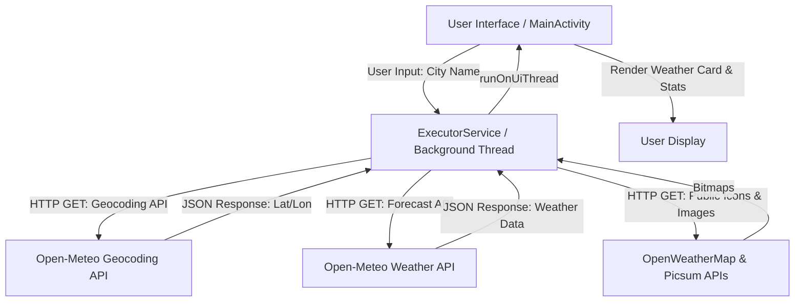

# WeatherNow — Real-Time Android Weather Application
### Practical Experiment: *“Access Web Services Using HTTP Requests in Android”*

**WeatherNow** is a modern, production-grade Android application developed in **Java** and **XML layouts** that demonstrates accessing live web services through HTTP GET requests using `HttpURLConnection`.

---

## 🏗️ System Design & Architecture

The application follows a clean separation of concerns and robust multithreading design to ensure the UI remains responsive during network operations.

### Architecture Diagram


### Key Technical Components:
1. **Networking Layer (`HttpURLConnection`)**:
   - Sends HTTP GET requests to public REST APIs without requiring API keys (Open-Meteo & OpenWeatherMap public image endpoints).
   - Configured with strict connection (10s) and read (10s) timeouts.
2. **Asynchronous Background Execution (`ExecutorService`)**:
   - Network requests, JSON parsing, and bitmap image decoding are executed on a dedicated background thread using `Executors.newSingleThreadExecutor()`.
3. **Main Thread UI Synchronization (`runOnUiThread`)**:
   - Safely updates UI views (`TextView`, `ImageView`, `ProgressBar`) once network data and bitmaps are successfully processed.
4. **Robust Error Handling**:
   - Catches network connectivity drops, timeouts, malformed JSON responses, and invalid city names with user-friendly error messages.

---

## 📱 Output Screenshots

Here is the application running on an Android device:

### 1. Main Weather Screen (Default / Searched City)


### 2. Weather Details & Quick Chips


---

## 💻 Core Code Implementation

### 1. `MainActivity.java`
```java
package com.example.exp_12;

import android.content.Context;
import android.graphics.Bitmap;
import android.graphics.BitmapFactory;
import android.net.ConnectivityManager;
import android.net.NetworkInfo;
import android.os.Bundle;
import android.text.TextUtils;
import android.view.View;
import android.view.inputmethod.InputMethodManager;
import android.widget.Button;
import android.widget.EditText;
import android.widget.ImageView;
import android.widget.ProgressBar;
import android.widget.TextView;
import android.widget.Toast;

import androidx.appcompat.app.AppCompatActivity;

import org.json.JSONArray;
import org.json.JSONException;
import org.json.JSONObject;

import java.io.BufferedReader;
import java.io.InputStream;
import java.io.InputStreamReader;
import java.net.HttpURLConnection;
import java.net.URL;
import java.util.concurrent.ExecutorService;
import java.util.concurrent.Executors;

public class MainActivity extends AppCompatActivity {

    private EditText etCity;
    private Button btnSearch, btnRefresh;
    private ProgressBar progressBar;
    private TextView tvError, tvCityName, tvTemperature, tvCondition, tvFeelsLike, tvHumidity, tvWindSpeed, tvMinTemp, tvMaxTemp;
    private ImageView ivWeatherIcon, ivCityIllustration;
    private View cardWeather;

    private ExecutorService executorService;
    private String lastSearchedCity = "Bengaluru";

    @Override
    protected void onCreate(Bundle savedInstanceState) {
        super.onCreate(savedInstanceState);
        setContentView(R.layout.activity_main);

        etCity = findViewById(R.id.etCity);
        btnSearch = findViewById(R.id.btnSearch);
        btnRefresh = findViewById(R.id.btnRefresh);
        progressBar = findViewById(R.id.progressBar);
        tvError = findViewById(R.id.tvError);
        tvCityName = findViewById(R.id.tvCityName);
        tvTemperature = findViewById(R.id.tvTemperature);
        tvCondition = findViewById(R.id.tvCondition);
        tvFeelsLike = findViewById(R.id.tvFeelsLike);
        tvHumidity = findViewById(R.id.tvHumidity);
        tvWindSpeed = findViewById(R.id.tvWindSpeed);
        tvMinTemp = findViewById(R.id.tvMinTemp);
        tvMaxTemp = findViewById(R.id.tvMaxTemp);
        ivWeatherIcon = findViewById(R.id.ivWeatherIcon);
        ivCityIllustration = findViewById(R.id.ivCityIllustration);
        cardWeather = findViewById(R.id.cardWeather);

        executorService = Executors.newSingleThreadExecutor();

        // Popular City Chips
        findViewById(R.id.chipBengaluru).setOnClickListener(v -> loadCityWeather("Bengaluru"));
        findViewById(R.id.chipLondon).setOnClickListener(v -> loadCityWeather("London"));
        findViewById(R.id.chipNewYork).setOnClickListener(v -> loadCityWeather("New York"));
        findViewById(R.id.chipTokyo).setOnClickListener(v -> loadCityWeather("Tokyo"));

        btnSearch.setOnClickListener(v -> {
            String city = etCity.getText().toString().trim();
            if (TextUtils.isEmpty(city)) {
                etCity.setError("Please enter a city name");
                return;
            }
            hideKeyboard();
            lastSearchedCity = city;
            fetchWeatherData(city);
        });

        btnRefresh.setOnClickListener(v -> {
            if (!TextUtils.isEmpty(lastSearchedCity)) {
                fetchWeatherData(lastSearchedCity);
            }
        });

        // Load default city on startup
        etCity.setText("Bengaluru");
        fetchWeatherData("Bengaluru");
    }

    private void loadCityWeather(String city) {
        etCity.setText(city);
        hideKeyboard();
        lastSearchedCity = city;
        fetchWeatherData(city);
    }

    private void fetchWeatherData(final String cityName) {
        if (!isNetworkAvailable()) {
            showError("Network error. Please check your internet connection.");
            return;
        }

        showLoading(true);

        executorService.execute(() -> {
            try {
                // Step 1: Geocoding
                String geoUrlStr = "https://geocoding-api.open-meteo.com/v1/search?name=" + 
                        java.net.URLEncoder.encode(cityName, "UTF-8") + "&count=1";
                String geoJsonResponse = makeHttpGETRequest(geoUrlStr);
                if (geoJsonResponse == null) {
                    showErrorOnUI("Network error while connecting to server.");
                    return;
                }

                JSONObject geoObj = new JSONObject(geoJsonResponse);
                if (!geoObj.has("results")) {
                    showErrorOnUI("City not found. Please check spelling.");
                    return;
                }

                JSONObject cityObj = geoObj.getJSONArray("results").getJSONObject(0);
                double lat = cityObj.getDouble("latitude");
                double lon = cityObj.getDouble("longitude");
                String name = cityObj.getString("name");
                String country = cityObj.has("country") ? cityObj.getString("country") : "";

                // Step 2: Weather Forecast API
                String weatherUrlStr = "https://api.open-meteo.com/v1/forecast?latitude=" + lat + 
                        "&longitude=" + lon + 
                        "&current=temperature_2m,relative_humidity_2m,apparent_temperature,weather_code,wind_speed_10m" + 
                        "&daily=temperature_2m_max,temperature_2m_min&timezone=auto";
                String weatherJsonResponse = makeHttpGETRequest(weatherUrlStr);
                if (weatherJsonResponse == null) {
                    showErrorOnUI("Failed to fetch weather forecast.");
                    return;
                }

                // Step 3: Load public API images
                int weatherCode = new JSONObject(weatherJsonResponse).getJSONObject("current").getInt("weather_code");
                String iconCode = getWeatherIconCode(weatherCode);
                String iconUrlStr = "https://openweathermap.org/img/wn/" + iconCode + "@4x.png";
                String illustrationUrlStr = "https://picsum.photos/seed/" + java.net.URLEncoder.encode(cityName, "UTF-8") + "/800/300";

                Bitmap weatherBitmap = downloadBitmapFromUrl(iconUrlStr);
                Bitmap illustrationBitmap = downloadBitmapFromUrl(illustrationUrlStr);

                parseAndDisplayWeather(weatherJsonResponse, name, country, weatherBitmap, illustrationBitmap);

            } catch (Exception e) {
                showErrorOnUI("Error: " + e.getMessage());
            }
        });
    }

    private String makeHttpGETRequest(String requestUrl) {
        HttpURLConnection connection = null;
        try {
            URL url = new URL(requestUrl);
            connection = (HttpURLConnection) url.openConnection();
            connection.setRequestMethod("GET");
            connection.setConnectTimeout(10000);
            connection.setReadTimeout(10000);
            connection.connect();

            if (connection.getResponseCode() == HttpURLConnection.HTTP_OK) {
                BufferedReader in = new BufferedReader(new InputStreamReader(connection.getInputStream()));
                StringBuilder response = new StringBuilder();
                String line;
                while ((line = in.readLine()) != null) {
                    response.append(line);
                }
                in.close();
                return response.toString();
            }
        } catch (Exception e) {
            // Ignored
        } finally {
            if (connection != null) connection.disconnect();
        }
        return null;
    }

    private Bitmap downloadBitmapFromUrl(String urlString) {
        HttpURLConnection connection = null;
        InputStream inputStream = null;
        try {
            URL url = new URL(urlString);
            connection = (HttpURLConnection) url.openConnection();
            connection.setDoInput(true);
            connection.setConnectTimeout(10000);
            connection.setReadTimeout(10000);
            connection.connect();
            inputStream = connection.getInputStream();
            return BitmapFactory.decodeStream(inputStream);
        } catch (Exception e) {
            return null;
        } finally {
            if (inputStream != null) {
                try { inputStream.close(); } catch (Exception ignored) {}
            }
            if (connection != null) connection.disconnect();
        }
    }

    private void parseAndDisplayWeather(String jsonResponse, String cityName, String country, Bitmap weatherBitmap, Bitmap illustrationBitmap) {
        try {
            JSONObject jsonObject = new JSONObject(jsonResponse);
            JSONObject currentObj = jsonObject.getJSONObject("current");
            JSONObject dailyObj = jsonObject.getJSONObject("daily");

            double temp = currentObj.getDouble("temperature_2m");
            double feelsLike = currentObj.getDouble("apparent_temperature");
            int humidity = currentObj.getInt("relative_humidity_2m");
            double windSpeed = currentObj.getDouble("wind_speed_10m");
            int weatherCode = currentObj.getInt("weather_code");

            double tempMax = dailyObj.getJSONArray("temperature_2m_max").getDouble(0);
            double tempMin = dailyObj.getJSONArray("temperature_2m_min").getDouble(0);

            String displayCity = TextUtils.isEmpty(country) ? cityName : cityName + ", " + country;
            String displayTemp = Math.round(temp) + "°C";
            String displayCondition = getWeatherConditionText(weatherCode);
            String displayFeelsLike = "Feels like: " + Math.round(feelsLike) + "°C";
            String displayHumidity = humidity + "%";
            String displayWind = Math.round(windSpeed) + " km/h";
            String displayMinTemp = Math.round(tempMin) + "°C";
            String displayMaxTemp = Math.round(tempMax) + "°C";
            int weatherIconRes = getWeatherIconRes(weatherCode);

            runOnUiThread(() -> {
                tvCityName.setText(displayCity);
                tvTemperature.setText(displayTemp);
                tvCondition.setText(displayCondition);
                tvFeelsLike.setText(displayFeelsLike);
                tvHumidity.setText(displayHumidity);
                tvWindSpeed.setText(displayWind);
                tvMinTemp.setText(displayMinTemp);
                tvMaxTemp.setText(displayMaxTemp);

                if (weatherBitmap != null) {
                    ivWeatherIcon.setImageBitmap(weatherBitmap);
                } else {
                    ivWeatherIcon.setImageResource(weatherIconRes);
                }
                if (illustrationBitmap != null) {
                    ivCityIllustration.setImageBitmap(illustrationBitmap);
                }

                showLoading(false);
                tvError.setVisibility(View.GONE);
                cardWeather.setVisibility(View.VISIBLE);
            });

        } catch (JSONException e) {
            showErrorOnUI("Error parsing weather JSON: " + e.getMessage());
        }
    }

    private String getWeatherConditionText(int code) {
        switch (code) {
            case 0: return "Clear Sky";
            case 1: case 2: case 3: return "Partly Cloudy";
            case 45: case 48: return "Foggy";
            case 51: case 53: case 55: case 56: case 57: return "Drizzle";
            case 61: case 63: case 65: case 66: case 67: return "Rainy";
            case 71: case 73: case 75: case 77: return "Snowy";
            case 95: case 96: case 99: return "Thunderstorm";
            default: return "Fair";
        }
    }

    private String getWeatherIconCode(int code) {
        switch (code) {
            case 0: return "01d";
            case 1: case 2: return "02d";
            case 3: return "04d";
            case 45: case 48: return "50d";
            case 51: case 53: case 55: case 56: case 57: return "09d";
            case 61: case 63: case 65: case 66: case 67: return "10d";
            case 71: case 73: case 75: case 77: return "13d";
            case 95: case 96: case 99: return "11d";
            default: return "01d";
        }
    }

    private int getWeatherIconRes(int code) {
        switch (code) {
            case 0: return R.drawable.ic_weather_sun;
            case 1: case 2: case 3: return R.drawable.ic_cloud;
            case 51: case 53: case 55: case 56: case 57: return R.drawable.ic_rain;
            case 61: case 63: case 65: case 66: case 67: return R.drawable.ic_rain;
            case 71: case 73: case 75: case 77: return R.drawable.ic_snow;
            case 95: case 96: case 99: return R.drawable.ic_storm;
            default: return R.drawable.ic_weather_sun;
        }
    }

    private void showErrorOnUI(String message) {
        runOnUiThread(() -> {
            tvError.setText(message);
            tvError.setVisibility(View.VISIBLE);
            cardWeather.setVisibility(View.GONE);
            progressBar.setVisibility(View.GONE);
        });
    }

    private boolean isNetworkAvailable() {
        ConnectivityManager cm = (ConnectivityManager) getSystemService(Context.CONNECTIVITY_SERVICE);
        if (cm != null) {
            NetworkInfo activeNetwork = cm.getActiveNetworkInfo();
            return activeNetwork != null && activeNetwork.isConnectedOrConnecting();
        }
        return false;
    }

    private void showLoading(boolean isLoading) {
        runOnUiThread(() -> {
            if (isLoading) {
                progressBar.setVisibility(View.VISIBLE);
                cardWeather.setVisibility(View.GONE);
                tvError.setVisibility(View.GONE);
                btnSearch.setEnabled(false);
                btnRefresh.setEnabled(false);
            } else {
                progressBar.setVisibility(View.GONE);
                btnSearch.setEnabled(true);
                btnRefresh.setEnabled(true);
            }
        });
    }

    private void showError(String message) {
        runOnUiThread(() -> {
            tvError.setText(message);
            tvError.setVisibility(View.VISIBLE);
            cardWeather.setVisibility(View.GONE);
            progressBar.setVisibility(View.GONE);
        });
    }

    private void hideKeyboard() {
        View view = this.getCurrentFocus();
        if (view != null) {
            InputMethodManager imm = (InputMethodManager) getSystemService(Context.INPUT_METHOD_SERVICE);
            if (imm != null) {
                imm.hideSoftInputFromWindow(view.getWindowToken(), 0);
            }
        }
    }

    @Override
    protected void onDestroy() {
        super.onDestroy();
        if (executorService != null) {
            executorService.shutdown();
        }
    }
}
```

---

### 2. `AndroidManifest.xml`
```xml
<?xml version="1.0" encoding="utf-8"?>
<manifest xmlns:android="http://schemas.android.com/apk/res/android"
    xmlns:tools="http://schemas.android.com/tools">

    <uses-permission android:name="android.permission.INTERNET" />
    <uses-permission android:name="android.permission.ACCESS_NETWORK_STATE" />

    <application
        android:allowBackup="true"
        android:dataExtractionRules="@xml/data_extraction_rules"
        android:fullBackupContent="@xml/backup_rules"
        android:icon="@mipmap/ic_launcher"
        android:label="@string/app_name"
        android:roundIcon="@mipmap/ic_launcher_round"
        android:supportsRtl="true"
        android:theme="@style/Theme.WeatherNow">
        <activity
            android:name=".MainActivity"
            android:exported="true"
            android:windowSoftInputMode="adjustResize">
            <intent-filter>
                <action android:name="android.intent.action.MAIN" />
                <category android:name="android.intent.category.LAUNCHER" />
            </intent-filter>
        </activity>
    </application>

</manifest>
```

---

## 🚀 How to Build and Run
1. Open the project in Android Studio.
2. Ensure you have internet connection enabled.
3. Click **Run 'app'** (`Shift + F10`) to build and deploy to your emulator or device.
