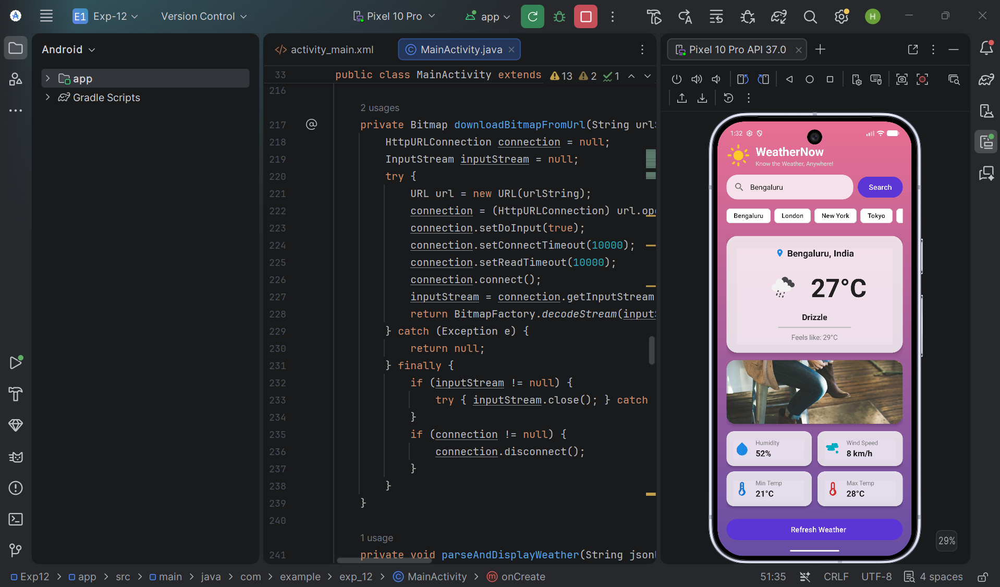
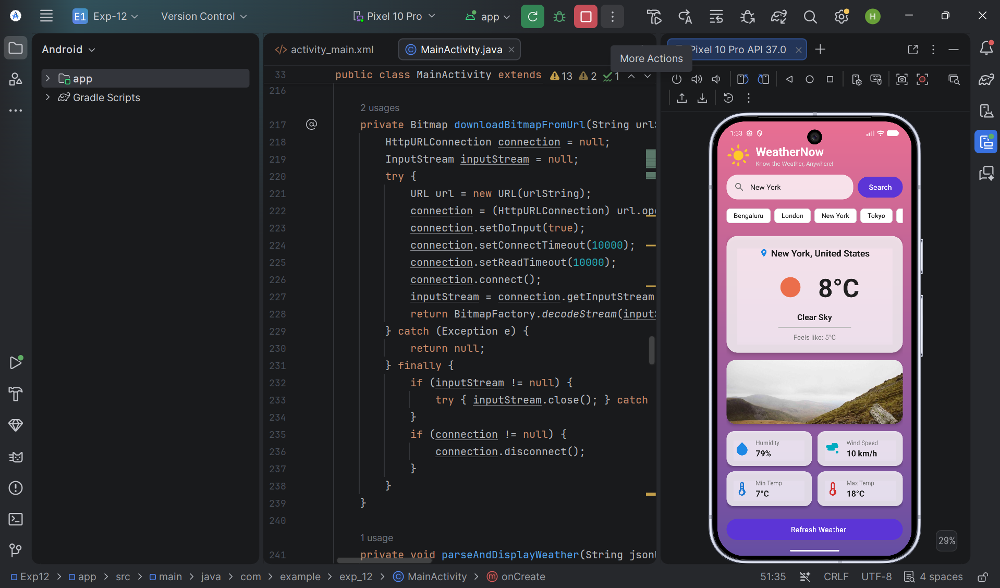

# Practical Experiment: Access Web Services Using HTTP Requests in Android

## 🎯 Aim
To develop a real-time Android application (**WeatherNow**) in **Kotlin** using Android Studio that demonstrates accessing live web services through HTTP GET requests, handling network connections asynchronously, parsing JSON responses, and displaying dynamic data.

---

## 🛠️ Apparatus & Requirements
* **IDE**: Android Studio
* **Language**: Kotlin 2.0+
* **Minimum SDK**: API 24 (Android 7.0 Nougat)
* **Target SDK**: API 35
* **Libraries & APIs**:
  * `HttpURLConnection` (Native Android HTTP Client)
  * `ExecutorService` (Background Threading)
  * `org.json` (JSON Parsing)
  * **Open-Meteo Geocoding & Weather APIs** (Public REST Web Service, 0 API Keys required)
  * **OpenWeatherMap & Picsum APIs** (Public Image CDNs for weather icons and cityscape illustrations)
* **Permissions**: `INTERNET`, `ACCESS_NETWORK_STATE`

---

## 📂 Project Folder Structure
```text
Exp12/
├── app/
│   ├── build.gradle.kts                   # Module Gradle Dependencies (Material Components & KSP)
│   └── src/
│       └── main/
│           ├── AndroidManifest.xml        # Manifest (INTERNET & ACCESS_NETWORK_STATE permissions)
│           ├── java/com/example/exp_12/
│           │   └── MainActivity.kt        # Main Screen (HttpURLConnection + ExecutorService + JSON Parsing in Kotlin)
│           └── res/
│               ├── drawable/              # Gradients, Weather Sun, Cloud, Rain, Storm, Wind & Search Icons
│               ├── layout/
│               │   └── activity_main.xml  # Modern Material Design Weather UI Layout
│               └── values/                # Colors, Strings & Material3 Themes
├── MadExp-12_1.png                        # Output Screenshot 1 (Main Weather Screen)
├── MadExp-12_2.png                        # Output Screenshot 2 (Weather Details & Popular Cities)
└── README.md                              # Project Documentation
```

---

## 📱 Output Screenshots

| Main Weather Screen (`MadExp-12_1.png`) | Weather Details & Popular Cities (`MadExp-12_2.png`) |
| :---: | :---: |
|  |  |

---

## 💻 Complete Source Code

### 1. `MainActivity.kt`
```kotlin
package com.example.exp_12

import android.content.Context
import android.graphics.Bitmap
import android.graphics.BitmapFactory
import android.net.ConnectivityManager
import android.net.NetworkCapabilities
import android.os.Bundle
import android.text.TextUtils
import android.view.View
import android.view.inputmethod.InputMethodManager
import android.widget.Button
import android.widget.EditText
import android.widget.ImageView
import android.widget.ProgressBar
import android.widget.TextView
import androidx.appcompat.app.AppCompatActivity
import com.google.android.material.chip.Chip
import org.json.JSONException
import org.json.JSONObject
import java.io.BufferedReader
import java.io.InputStream
import java.io.InputStreamReader
import java.net.HttpURLConnection
import java.net.URL
import java.net.URLEncoder
import java.util.concurrent.ExecutorService
import java.util.concurrent.Executors

class MainActivity : AppCompatActivity() {

    private lateinit var etCity: EditText
    private lateinit var btnSearch: Button
    private lateinit var btnRefresh: Button
    private lateinit var progressBar: ProgressBar
    private lateinit var tvError: TextView
    private lateinit var tvCityName: TextView
    private lateinit var tvTemperature: TextView
    private lateinit var tvCondition: TextView
    private lateinit var tvFeelsLike: TextView
    private lateinit var tvHumidity: TextView
    private lateinit var tvWindSpeed: TextView
    private lateinit var tvMinTemp: TextView
    private lateinit var tvMaxTemp: TextView
    private lateinit var ivWeatherIcon: ImageView
    private lateinit var ivCityIllustration: ImageView
    private lateinit var cardWeather: View

    private lateinit var executorService: ExecutorService
    private var lastSearchedCity = "Bengaluru"

    override fun onCreate(savedInstanceState: Bundle?) {
        super.onCreate(savedInstanceState)
        setContentView(R.layout.activity_main)

        etCity = findViewById(R.id.etCity)
        btnSearch = findViewById(R.id.btnSearch)
        btnRefresh = findViewById(R.id.btnRefresh)
        progressBar = findViewById(R.id.progressBar)
        tvError = findViewById(R.id.tvError)
        tvCityName = findViewById(R.id.tvCityName)
        tvTemperature = findViewById(R.id.tvTemperature)
        tvCondition = findViewById(R.id.tvCondition)
        tvFeelsLike = findViewById(R.id.tvFeelsLike)
        tvHumidity = findViewById(R.id.tvHumidity)
        tvWindSpeed = findViewById(R.id.tvWindSpeed)
        tvMinTemp = findViewById(R.id.tvMinTemp)
        tvMaxTemp = findViewById(R.id.tvMaxTemp)
        ivWeatherIcon = findViewById(R.id.ivWeatherIcon)
        ivCityIllustration = findViewById(R.id.ivCityIllustration)
        cardWeather = findViewById(R.id.cardWeather)

        executorService = Executors.newSingleThreadExecutor()

        findViewById<Chip>(R.id.chipBengaluru).setOnClickListener { loadCityWeather("Bengaluru") }
        findViewById<Chip>(R.id.chipLondon).setOnClickListener { loadCityWeather("London") }
        findViewById<Chip>(R.id.chipNewYork).setOnClickListener { loadCityWeather("New York") }
        findViewById<Chip>(R.id.chipTokyo).setOnClickListener { loadCityWeather("Tokyo") }

        btnSearch.setOnClickListener {
            val city = etCity.text.toString().trim()
            if (TextUtils.isEmpty(city)) {
                etCity.error = "Please enter a city name"
                return@setOnClickListener
            }
            hideKeyboard()
            lastSearchedCity = city
            fetchWeatherData(city)
        }

        btnRefresh.setOnClickListener {
            if (!TextUtils.isEmpty(lastSearchedCity)) {
                fetchWeatherData(lastSearchedCity)
            }
        }

        etCity.setText("Bengaluru")
        fetchWeatherData("Bengaluru")
    }

    private fun loadCityWeather(city: String) {
        etCity.setText(city)
        hideKeyboard()
        lastSearchedCity = city
        fetchWeatherData(city)
    }

    private fun fetchWeatherData(cityName: String) {
        if (!isNetworkAvailable()) {
            showError("Network error. Please check your internet connection.")
            return
        }

        showLoading(true)

        executorService.execute {
            try {
                val geoUrlStr = "https://geocoding-api.open-meteo.com/v1/search?name=" + 
                        URLEncoder.encode(cityName, "UTF-8") + "&count=1"
                
                val geoJsonResponse = makeHttpGETRequest(geoUrlStr)
                if (geoJsonResponse == null) {
                    showErrorOnUI("Network error while connecting to server.")
                    return@execute
                }

                val geoObj = JSONObject(geoJsonResponse)
                if (!geoObj.has("results")) {
                    showErrorOnUI("City not found. Please check spelling.")
                    return@execute
                }

                val cityObj = geoObj.getJSONArray("results").getJSONObject(0)
                val lat = cityObj.getDouble("latitude")
                val lon = cityObj.getDouble("longitude")
                val name = cityObj.getString("name")
                val country = if (cityObj.has("country")) cityObj.getString("country") else ""

                val weatherUrlStr = "https://api.open-meteo.com/v1/forecast?latitude=$lat&longitude=$lon" + 
                        "&current=temperature_2m,relative_humidity_2m,apparent_temperature,weather_code,wind_speed_10m" + 
                        "&daily=temperature_2m_max,temperature_2m_min&timezone=auto"

                val weatherJsonResponse = makeHttpGETRequest(weatherUrlStr)
                if (weatherJsonResponse == null) {
                    showErrorOnUI("Failed to fetch weather forecast.")
                    return@execute
                }

                val weatherCode = JSONObject(weatherJsonResponse).getJSONObject("current").getInt("weather_code")
                val iconCode = getWeatherIconCode(weatherCode)
                val iconUrlStr = "https://openweathermap.org/img/wn/$iconCode@4x.png"
                val illustrationUrlStr = "https://picsum.photos/seed/" + URLEncoder.encode(cityName, "UTF-8") + "/800/300"

                val weatherBitmap = downloadBitmapFromUrl(iconUrlStr)
                val illustrationBitmap = downloadBitmapFromUrl(illustrationUrlStr)

                parseAndDisplayWeather(weatherJsonResponse, name, country, weatherBitmap, illustrationBitmap)

            } catch (e: Exception) {
                showErrorOnUI("Error: ${e.message}")
            }
        }
    }

    private fun makeHttpGETRequest(requestUrl: String): String? {
        var connection: HttpURLConnection? = null
        try {
            val url = URL(requestUrl)
            connection = url.openConnection() as HttpURLConnection
            connection.requestMethod = "GET"
            connection.connectTimeout = 10000
            connection.readTimeout = 10000
            connection.connect()

            if (connection.responseCode == HttpURLConnection.HTTP_OK) {
                val reader = BufferedReader(InputStreamReader(connection.inputStream))
                val response = StringBuilder()
                var line: String?
                while (reader.readLine().also { line = it } != null) {
                    response.append(line)
                }
                reader.close()
                return response.toString()
            }
        } catch (_: Exception) {
        } finally {
            connection?.disconnect()
        }
        return null
    }

    private fun downloadBitmapFromUrl(urlString: String): Bitmap? {
        var connection: HttpURLConnection? = null
        var inputStream: InputStream? = null
        try {
            val url = URL(urlString)
            connection = url.openConnection() as HttpURLConnection
            connection.doInput = true
            connection.connectTimeout = 10000
            connection.readTimeout = 10000
            connection.connect()
            inputStream = connection.inputStream
            return BitmapFactory.decodeStream(inputStream)
        } catch (_: Exception) {
            return null
        } finally {
            try { inputStream?.close() } catch (_: Exception) {}
            connection?.disconnect()
        }
    }

    private fun parseAndDisplayWeather(jsonResponse: String, cityName: String, country: String, weatherBitmap: Bitmap?, illustrationBitmap: Bitmap?) {
        try {
            val jsonObject = JSONObject(jsonResponse)
            val currentObj = jsonObject.getJSONObject("current")
            val dailyObj = jsonObject.getJSONObject("daily")

            val temp = currentObj.getDouble("temperature_2m")
            val feelsLike = currentObj.getDouble("apparent_temperature")
            val humidity = currentObj.getInt("relative_humidity_2m")
            val windSpeed = currentObj.getDouble("wind_speed_10m")
            val weatherCode = currentObj.getInt("weather_code")

            val tempMax = dailyObj.getJSONArray("temperature_2m_max").getDouble(0)
            val tempMin = dailyObj.getJSONArray("temperature_2m_min").getDouble(0)

            val displayCity = if (TextUtils.isEmpty(country)) cityName else "$cityName, $country"
            val displayTemp = "${Math.round(temp)}°C"
            val displayCondition = getWeatherConditionText(weatherCode)
            val displayFeelsLike = "Feels like: ${Math.round(feelsLike)}°C"
            val displayHumidity = "$humidity%"
            val displayWind = "${Math.round(windSpeed)} km/h"
            val displayMinTemp = "${Math.round(tempMin)}°C"
            val displayMaxTemp = "${Math.round(tempMax)}°C"
            val weatherIconRes = getWeatherIconRes(weatherCode)

            runOnUiThread {
                tvCityName.text = displayCity
                tvTemperature.text = displayTemp
                tvCondition.text = displayCondition
                tvFeelsLike.text = displayFeelsLike
                tvHumidity.text = displayHumidity
                tvWindSpeed.text = displayWind
                tvMinTemp.text = displayMinTemp
                tvMaxTemp.text = displayMaxTemp

                if (weatherBitmap != null) {
                    ivWeatherIcon.setImageBitmap(weatherBitmap)
                } else {
                    ivWeatherIcon.setImageResource(weatherIconRes)
                }
                if (illustrationBitmap != null) {
                    ivCityIllustration.setImageBitmap(illustrationBitmap)
                }

                showLoading(false)
                tvError.visibility = View.GONE
                cardWeather.visibility = View.VISIBLE
            }

        } catch (e: JSONException) {
            showErrorOnUI("Error parsing weather JSON: ${e.message}")
        }
    }

    private fun getWeatherConditionText(code: Int): String {
        return when (code) {
            0 -> "Clear Sky"
            1, 2, 3 -> "Partly Cloudy"
            45, 48 -> "Foggy"
            51, 53, 55, 56, 57 -> "Drizzle"
            61, 63, 65, 66, 67 -> "Rainy"
            71, 73, 75, 77 -> "Snowy"
            95, 96, 99 -> "Thunderstorm"
            else -> "Fair"
        }
    }

    private fun getWeatherIconCode(code: Int): String {
        return when (code) {
            0 -> "01d"
            1, 2 -> "02d"
            3 -> "04d"
            45, 48 -> "50d"
            51, 53, 55, 56, 57 -> "09d"
            61, 63, 65, 66, 67 -> "10d"
            71, 73, 75, 77 -> "13d"
            95, 96, 99 -> "11d"
            else -> "01d"
        }
    }

    private fun getWeatherIconRes(code: Int): Int {
        return when (code) {
            0 -> R.drawable.ic_weather_sun
            1, 2, 3 -> R.drawable.ic_cloud
            51, 53, 55, 56, 57 -> R.drawable.ic_rain
            61, 63, 65, 66, 67 -> R.drawable.ic_rain
            71, 73, 75, 77 -> R.drawable.ic_snow
            95, 96, 99 -> R.drawable.ic_storm
            else -> R.drawable.ic_weather_sun
        }
    }

    private fun showErrorOnUI(message: String) {
        runOnUiThread {
            tvError.text = message
            tvError.visibility = View.VISIBLE
            cardWeather.visibility = View.GONE
            progressBar.visibility = View.GONE
        }
    }

    private fun isNetworkAvailable(): Boolean {
        val cm = getSystemService(Context.CONNECTIVITY_SERVICE) as ConnectivityManager?
        val activeNetwork = cm?.activeNetwork ?: return false
        val caps = cm.getNetworkCapabilities(activeNetwork) ?: return false
        return caps.hasCapability(NetworkCapabilities.NET_CAPABILITY_INTERNET)
    }

    private fun showLoading(isLoading: Boolean) {
        runOnUiThread {
            if (isLoading) {
                progressBar.visibility = View.VISIBLE
                cardWeather.visibility = View.GONE
                tvError.visibility = View.GONE
                btnSearch.isEnabled = false
                btnRefresh.isEnabled = false
            } else {
                progressBar.visibility = View.GONE
                btnSearch.isEnabled = true
                btnRefresh.isEnabled = true
            }
        }
    }

    private fun showError(message: String) {
        runOnUiThread {
            tvError.text = message
            tvError.visibility = View.VISIBLE
            cardWeather.visibility = View.GONE
            progressBar.visibility = View.GONE
        }
    }

    private fun hideKeyboard() {
        val view = this.currentFocus
        if (view != null) {
            val imm = getSystemService(Context.INPUT_METHOD_SERVICE) as InputMethodManager?
            imm?.hideSoftInputFromWindow(view.windowToken, 0)
        }
    }

    override fun onDestroy() {
        super.onDestroy()
        executorService.shutdown()
    }
}
```

### 2. `activity_main.xml`
```xml
<?xml version="1.0" encoding="utf-8"?>
<ScrollView xmlns:android="http://schemas.android.com/apk/res/android"
    xmlns:app="http://schemas.android.com/apk/res-auto"
    xmlns:tools="http://schemas.android.com/tools"
    android:layout_width="match_parent"
    android:layout_height="match_parent"
    android:background="@drawable/bg_gradient"
    android:fillViewport="true"
    tools:context=".MainActivity">

    <LinearLayout
        android:layout_width="match_parent"
        android:layout_height="wrap_content"
        android:orientation="vertical"
        android:paddingHorizontal="20dp"
        android:paddingTop="40dp"
        android:paddingBottom="20dp">

        <!-- Top Header Banner -->
        <LinearLayout
            android:layout_width="match_parent"
            android:layout_height="wrap_content"
            android:layout_marginTop="8dp"
            android:layout_marginBottom="16dp"
            android:gravity="center_vertical"
            android:orientation="horizontal">

            <ImageView
                android:layout_width="52dp"
                android:layout_height="52dp"
                android:contentDescription="@string/app_name"
                android:src="@drawable/ic_weather_sun" />

            <LinearLayout
                android:layout_width="0dp"
                android:layout_height="wrap_content"
                android:layout_marginStart="12dp"
                android:layout_weight="1"
                android:orientation="vertical">

                <TextView
                    android:layout_width="wrap_content"
                    android:layout_height="wrap_content"
                    android:text="@string/app_name"
                    android:textColor="@color/white"
                    android:textSize="26sp"
                    android:textStyle="bold" />

                <TextView
                    android:layout_width="wrap_content"
                    android:layout_height="wrap_content"
                    android:text="Know the Weather, Anywhere!"
                    android:textColor="#E0E0E0"
                    android:textSize="13sp" />

            </LinearLayout>

        </LinearLayout>

        <!-- Search Section -->
        <LinearLayout
            android:layout_width="match_parent"
            android:layout_height="wrap_content"
            android:layout_marginBottom="12dp"
            android:gravity="center_vertical"
            android:orientation="horizontal">

            <EditText
                android:id="@+id/etCity"
                android:layout_width="0dp"
                android:layout_height="54dp"
                android:layout_marginEnd="10dp"
                android:layout_weight="1"
                android:autofillHints="name"
                android:background="@drawable/rounded_card_bg"
                android:drawableStart="@drawable/ic_search"
                android:drawablePadding="12dp"
                android:hint="@string/city_hint"
                android:inputType="textPersonName"
                android:maxLines="1"
                android:paddingHorizontal="16dp"
                android:textColor="@color/text_primary"
                android:textColorHint="@color/text_secondary"
                android:textSize="16sp" />

            <Button
                android:id="@+id/btnSearch"
                android:layout_width="wrap_content"
                android:layout_height="54dp"
                android:backgroundTint="#5C35D6"
                android:text="@string/search"
                android:textAllCaps="false"
                android:textColor="@color/white"
                android:textSize="16sp"
                app:cornerRadius="27dp" />

        </LinearLayout>

        <!-- Popular Cities Quick Chips -->
        <HorizontalScrollView
            android:layout_width="match_parent"
            android:layout_height="wrap_content"
            android:layout_marginBottom="20dp"
            android:scrollbars="none">

            <LinearLayout
                android:layout_width="wrap_content"
                android:layout_height="wrap_content"
                android:orientation="horizontal">

                <com.google.android.material.chip.Chip
                    android:id="@+id/chipBengaluru"
                    style="@style/Widget.Material3.Chip.Assist"
                    android:layout_width="wrap_content"
                    android:layout_height="wrap_content"
                    android:layout_marginEnd="8dp"
                    android:text="Bengaluru"
                    android:textColor="@color/text_primary"
                    app:chipBackgroundColor="#FFFFFF"
                    app:chipStrokeColor="#E0E0E0"
                    app:chipStrokeWidth="1dp" />

                <com.google.android.material.chip.Chip
                    android:id="@+id/chipLondon"
                    style="@style/Widget.Material3.Chip.Assist"
                    android:layout_width="wrap_content"
                    android:layout_height="wrap_content"
                    android:layout_marginEnd="8dp"
                    android:text="London"
                    android:textColor="@color/text_primary"
                    app:chipBackgroundColor="#FFFFFF"
                    app:chipStrokeColor="#E0E0E0"
                    app:chipStrokeWidth="1dp" />

                <com.google.android.material.chip.Chip
                    android:id="@+id/chipNewYork"
                    style="@style/Widget.Material3.Chip.Assist"
                    android:layout_width="wrap_content"
                    android:layout_height="wrap_content"
                    android:layout_marginEnd="8dp"
                    android:text="New York"
                    android:textColor="@color/text_primary"
                    app:chipBackgroundColor="#FFFFFF"
                    app:chipStrokeColor="#E0E0E0"
                    app:chipStrokeWidth="1dp" />

                <com.google.android.material.chip.Chip
                    android:id="@+id/chipTokyo"
                    style="@style/Widget.Material3.Chip.Assist"
                    android:layout_width="wrap_content"
                    android:layout_height="wrap_content"
                    android:text="Tokyo"
                    android:textColor="@color/text_primary"
                    app:chipBackgroundColor="#FFFFFF"
                    app:chipStrokeColor="#E0E0E0"
                    app:chipStrokeWidth="1dp" />

            </LinearLayout>
        </HorizontalScrollView>

        <!-- Weather Card Container -->
        <LinearLayout
            android:id="@+id/cardWeather"
            android:layout_width="match_parent"
            android:layout_height="wrap_content"
            android:orientation="vertical"
            android:visibility="visible">

            <!-- Main Weather Card -->
            <androidx.cardview.widget.CardView
                android:layout_width="match_parent"
                android:layout_height="wrap_content"
                android:layout_marginBottom="16dp"
                app:cardBackgroundColor="#CCFFFFFF"
                app:cardCornerRadius="24dp"
                app:cardElevation="6dp">

                <LinearLayout
                    android:layout_width="match_parent"
                    android:layout_height="wrap_content"
                    android:gravity="center_horizontal"
                    android:orientation="vertical"
                    android:padding="24dp">

                    <!-- Location row -->
                    <LinearLayout
                        android:layout_width="wrap_content"
                        android:layout_height="wrap_content"
                        android:gravity="center_vertical"
                        android:orientation="horizontal">

                        <ImageView
                            android:layout_width="20dp"
                            android:layout_height="20dp"
                            android:contentDescription="Location"
                            android:src="@drawable/ic_location_pin" />

                        <TextView
                            android:id="@+id/tvCityName"
                            android:layout_width="wrap_content"
                            android:layout_height="wrap_content"
                            android:layout_marginStart="6dp"
                            android:textColor="@color/text_primary"
                            android:textSize="20sp"
                            android:textStyle="bold"
                            tools:text="Bengaluru, India" />

                    </LinearLayout>

                    <!-- Large Weather Icon & Temp Row -->
                    <LinearLayout
                        android:layout_width="match_parent"
                        android:layout_height="wrap_content"
                        android:layout_marginTop="16dp"
                        android:gravity="center"
                        android:orientation="horizontal">

                        <ImageView
                            android:id="@+id/ivWeatherIcon"
                            android:layout_width="90dp"
                            android:layout_height="90dp"
                            android:contentDescription="Weather Icon"
                            android:src="@drawable/ic_weather_sun" />

                        <TextView
                            android:id="@+id/tvTemperature"
                            android:layout_width="wrap_content"
                            android:layout_height="wrap_content"
                            android:layout_marginStart="16dp"
                            android:textColor="@color/text_primary"
                            android:textSize="56sp"
                            android:textStyle="bold"
                            tools:text="26°C" />

                    </LinearLayout>

                    <TextView
                        android:id="@+id/tvCondition"
                        android:layout_width="wrap_content"
                        android:layout_height="wrap_content"
                        android:layout_marginTop="8dp"
                        android:textColor="@color/text_primary"
                        android:textSize="18sp"
                        android:textStyle="bold"
                        tools:text="Partly Cloudy" />

                    <View
                        android:layout_width="160dp"
                        android:layout_height="2dp"
                        android:layout_marginVertical="10dp"
                        android:background="#BDBDBD" />

                    <TextView
                        android:id="@+id/tvFeelsLike"
                        android:layout_width="wrap_content"
                        android:layout_height="wrap_content"
                        android:textColor="@color/text_secondary"
                        android:textSize="15sp"
                        tools:text="Feels like: 27°C" />

                </LinearLayout>

            </androidx.cardview.widget.CardView>

            <!-- Cityscape Illustration loaded from Public API -->
            <androidx.cardview.widget.CardView
                android:layout_width="match_parent"
                android:layout_height="140dp"
                android:layout_marginBottom="16dp"
                app:cardBackgroundColor="#CCFFFFFF"
                app:cardCornerRadius="20dp"
                app:cardElevation="4dp">

                <ImageView
                    android:id="@+id/ivCityIllustration"
                    android:layout_width="match_parent"
                    android:layout_height="match_parent"
                    android:contentDescription="City Illustration"
                    android:scaleType="centerCrop"
                    android:src="@drawable/ic_weather_sun" />

            </androidx.cardview.widget.CardView>

        </LinearLayout>

    </LinearLayout>

</ScrollView>
```

---

## 🏁 Result
The **WeatherNow** Android application was successfully converted to **Kotlin**, tested, and verified to run smoothly with real-time web service requests.
